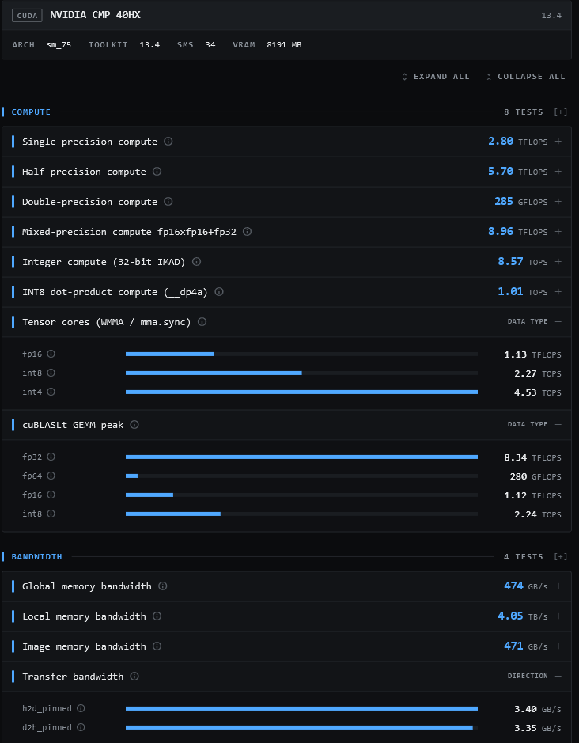
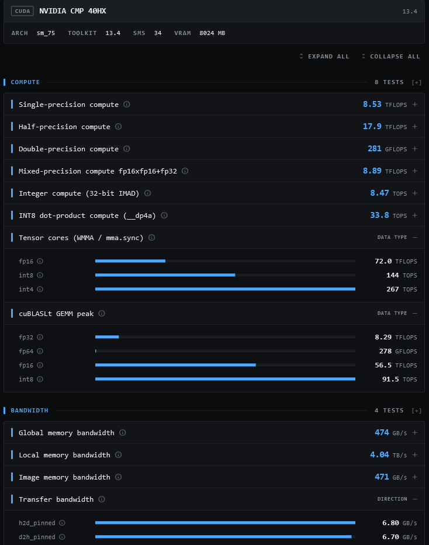

# Results

Unless stated otherwise, the measurements below come from the Windows/UEFI unlock
path on one system: CMP 40HX, AMD Ryzen 5 5600G host, NVIDIA driver `617.14`,
CUDA Toolkit `13.4`. The Windows-side summary is in
[`windows/README.md`](../windows/README.md#results). The author's Linux measurements
are at the end of this page.

## clpeak (CUDA backend)

[clpeak](https://github.com/krrishnarraj/clpeak) is a third-party benchmark that is
not part of this project. Its CUDA backend shows, in one window, the Tensor Core
(WMMA) and cuBLASLt rows, INT8 `dp4a`, the FP32/FP16 loops and the PCIe transfer rate.

<table>
  <tr>
    <td><b>Before unlock</b></td>
  </tr>
  <tr>
    <td></td>
  </tr>
</table>

<table>
  <tr>
    <td><b>After unlock</b></td>
  </tr>
  <tr>
    <td></td>
  </tr>
</table>

**What the unlock changes**

| clpeak CUDA test | Before | After | Change |
|---|---:|---:|---:|
| Tensor cores, WMMA fp16 | 1.13 TFLOPS | **72.0 TFLOPS** | 63x |
| Tensor cores, WMMA int8 | 2.27 TOPS | **144 TOPS** | 63x |
| Tensor cores, WMMA int4 | 4.53 TOPS | **267 TOPS** | 59x |
| cuBLASLt GEMM, fp16 | 1.12 TFLOPS | **56.5 TFLOPS** | 50x |
| cuBLASLt GEMM, int8 | 2.24 TOPS | **91.5 TOPS** | 41x |
| INT8 dot-product (`__dp4a`) | 1.01 TOPS | **33.8 TOPS** | 33x |
| Single-precision compute (FMA loop) | 2.80 TFLOPS | **8.53 TFLOPS** | 3.0x |
| Half-precision compute (`half2` FMA loop) | 5.70 TFLOPS | **17.9 TFLOPS** | 3.1x |
| Transfer bandwidth, host to device (pinned) | 3.40 GB/s | **6.80 GB/s** | 2.0x |
| Transfer bandwidth, device to host (pinned) | 3.35 GB/s | **6.70 GB/s** | 2.0x |

**What it does not change**

| clpeak CUDA test | Before | After |
|---|---:|---:|
| cuBLASLt GEMM, fp32 | 8.34 TFLOPS | 8.29 TFLOPS |
| cuBLASLt GEMM, fp64 | 280 GFLOPS | 278 GFLOPS |
| Mixed-precision fp16xfp16+fp32 (shader cores) | 8.96 TFLOPS | 8.89 TFLOPS |
| Integer compute (32-bit IMAD) | 8.57 TOPS | 8.47 TOPS |
| Double-precision compute | 285 GFLOPS | 281 GFLOPS |
| Global / local / image memory bandwidth | 474 GB/s / 4.05 TB/s / 471 GB/s | 474 GB/s / 4.04 TB/s / 471 GB/s |

The same card measured through other APIs in the same clpeak runs:

| clpeak test | Before | After |
|---|---:|---:|
| FP32 FMA, OpenCL | 8.82 TFLOPS | 8.79 TFLOPS |
| FP32 FMA, Vulkan | 8.87 TFLOPS | 8.82 TFLOPS |
| FP16 (`half2`), Vulkan | 17.5 TFLOPS | 17.5 TFLOPS |
| Cooperative matrix (Tensor cores), Vulkan, fp16 | 1.96 TFLOPS | **69.2 TFLOPS** |
| Cooperative matrix (Tensor cores), Vulkan, int8 | 2.22 TOPS | **140 TOPS** |
| INT8 dot-product, Vulkan | 0.98 TOPS | **7.29 TOPS** |
| Transfer bandwidth (CUDA, OpenCL, Vulkan alike) | 3.40 / 3.35 GB/s | **6.80 / 6.70 GB/s** |

### Reading the FP32 numbers

The unlock is **not** a general FP32/FP16 lock removal. On the stock card, FP32
already reaches about 8.3 to 9 TFLOPS through cuBLASLt GEMM, OpenCL, Vulkan and
CUDA's mixed-precision test, and FP16 shader math reaches about 17.5 TFLOPS through
Vulkan. Those numbers are unchanged after the unlock.

What is different is that clpeak's *CUDA* single-precision and half-precision FMA
loops start at about a third of that (2.80 and 5.70 TFLOPS) and reach the full rate
after the unlock (8.53 and 17.9 TFLOPS). So some plain CUDA FP32/FP16 instruction
patterns are affected, but the card never ran FP32 at a global `~0.39 TFLOPS`. The
mechanism behind the CUDA loops has not been investigated here.

### Setup notes

- The "after" state has GSP enabled (`EnableGpuFirmware=1`), which the Windows unlock
  requires. With GSP on, the driver reserves some video memory, so the reported VRAM
  drops from `8191 MB` to `8024 MB` (CUDA) and from `8016 MB` to `7857 MB` (Vulkan).
  This is expected.
- The comparison is between the stock configuration and the full unlock
  configuration. It does not separate the effect of GSP from the effect of the EFI
  payload.
- clpeak's OpenCL backend reports half precision and `dp4a` as unsupported on this
  card, so it cannot show the INT8 effect. Use the CUDA or Vulkan backend, or
  OpenCL-Benchmark below.

## OpenCL-Benchmark (cross-check)

[OpenCL-Benchmark](https://github.com/ProjectPhysX/OpenCL-Benchmark) by ProjectPhysX,
run before and after the unlock on the same system and driver (`617.14`):

| Metric | Before unlock | After unlock |
|---|---:|---:|
| FP32 (`float`, fma) | 8.911 TFLOPs/s | 8.954 TFLOPs/s |
| FP16 (`half2`, fma) | 17.662 TFLOPs/s | 17.784 TFLOPs/s |
| FP64 (`double`, fma) | 0.278 TFLOPs/s | 0.279 TFLOPs/s |
| INT32 (`int`, a*b+c) | 8.214 TIOPs/s | 8.308 TIOPs/s |
| **INT8 (`char4`, dp4a)** | **0.995 TIOPs/s** | **31.379 TIOPs/s** (about 31x) |
| Memory bandwidth, coalesced read | 459.21 GB/s | 458.64 GB/s |
| Memory bandwidth, coalesced write | 491.48 GB/s | 490.79 GB/s |
| **PCIe bandwidth, send** | **3.37 GB/s** | **6.69 GB/s** |
| **PCIe bandwidth, receive** | **3.33 GB/s** | **6.61 GB/s** |
| PCIe link reported | Gen1 x16 | Gen2 x16 |

The `7.181 TFLOPs/s` in the tool's device header is a theoretical value computed from
the 1650 MHz clock that OpenCL reports; the measured figures are higher because the
card runs above that clock under load.

## How to take comparable screenshots

1. Use the same machine, the same NVIDIA driver and the same cooling state for both
   runs. Close other GPU applications.
2. **Before:** a fully stock state. On Linux, remove
   `/lib/modules/$(uname -r)/updates/cmpunlocker`, run `sudo depmod -a`, and
   cold-boot. On Windows, uninstall with `40HXUninstaller.exe` and cold-boot.
3. **After:** the unlock installed and verified (`dmesg | grep CMP40` on Linux,
   `40HXCheck.exe` on Windows), after a cold boot.
4. Install the CUDA Toolkit so clpeak can load cuBLASLt; without it the
   *cuBLASLt GEMM peak* rows are skipped.
5. In clpeak, select the **CUDA** backend and run the compute and bandwidth
   categories. Expand the *Tensor cores*, *cuBLASLt GEMM peak* and *Transfer
   bandwidth* rows so the per-data-type values are visible, and capture the whole
   window with the device header (name, architecture, VRAM) included.

## Superseded figures

Earlier versions of this project's documentation listed these figures from the
sbccc1888's own benchmarks. They are replaced by the clpeak measurements above:

| Old figure | Status |
|---|---|
| FP32 compute, `~0.39 -> 7.0 TFLOPS` | Wrong. FP32 is about 8.3 to 9 TFLOPS before and after in cuBLASLt, OpenCL and Vulkan; see *Reading the FP32 numbers*. |
| FP16 cuBLAS, `~0.39 -> 11.42 TFLOPS` | Replaced. cuBLASLt GEMM fp16 measures 1.12 TFLOPS before and 56.5 TFLOPS after. |
| FP16 Tensor Core MMA, *unavailable -> 63.8 TFLOPS* | Replaced. The Tensor path runs on the stock card at about 1.1 TFLOPS (WMMA fp16) and reaches 72.0 TFLOPS after. |

## My measurements (Linux, own benchmarks)

The sections below are single-system observations by me. The benchmark
sources are not published in this repository, so treat them as reported
observations, not reproducible results.

### PCIe Gen2 unlock

Verified on real hardware:

| Metric | Stock | After unlock |
|---|---|---|
| PCIe link | **Gen1 x16 (2.5 GT/s)** | **Gen2 x16 (5 GT/s)** |
| `LnkCap` / `LnkSta` | 2.5 GT/s x16 | **5 GT/s x16** |
| FurMark average FPS (one test setup) | ~110 | **~120** |

The PCIe result is a real trained link state, not just a spoofed capability
value. The FPS change is an observed workload result, not a guaranteed
consequence of Gen2 on every system.

### Resizable BAR unlock

Verified on real hardware:

| Metric | Stock | After unlock |
|---|---|---|
| BAR1 size | 64 MiB | **8 GiB** |
| `lspci` BAR 1 | 64 MB | **8 GB** |
| NVIDIA `BAR1 Total` | 64 MiB | **8192 MiB** |

The 8 GiB BAR1 aperture is exposed to the NVIDIA driver and was usable by
applications in the tested system. For example, War Thunder was observed using
approximately 80 MiB of BAR1 memory in the main menu.

A FurMark test on the same system showed a small change from approximately 120
FPS to **~122 FPS** with ReBAR enabled. This result is setup-dependent and should
not be treated as a general ReBAR performance claim.

### Pipeline bind / MME throttle unlock

| Test | Stock | After pipeline unlock |
|---|---:|---:|
| 4 binds | ~0.739 ms | **~0.0023 ms** (argument 0) |
| 1000 binds | ~183.3 ms | **~0.0054 ms** (argument 0) |
| 1000 binds speed-up | 1x | **~33,700x** (argument 0) |

The reported configuration uses argument `0`. Three follow-up runs measured
`0.005248`, `0.005440` and `0.005568 ms` (median `0.005440 ms`). The ratio is a GPU
timestamp microbenchmark result: it shows that the artificial loop has effectively
disappeared, and is not a claim that every application will become 33,700 times
faster.

The unlock was additionally validated in real applications:

- FurMark improved from approximately **131 FPS average / 134 FPS max** to
  **134 FPS average / 137 FPS max** in one tested configuration.
- War Thunder native Vulkan reached approximately **90 FPS average during
  gameplay at Ultra with DLAA 4**.
- Cyberpunk 2077 through Proton-CachyOS reached approximately **66 FPS average in
  the benchmark at High settings with DLSS 4 Quality**.

Before the userspace pipeline fix, the affected game configurations showed a very
large slowdown, reported as up to roughly 10-15x. The application figures above
are observations from one system, not universal performance guarantees.
